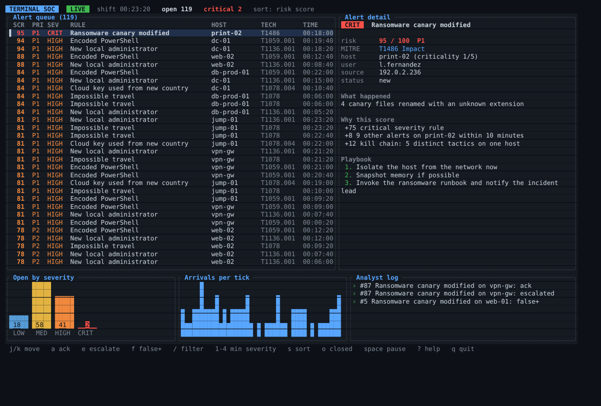

# Terminal SOC

[](https://github.com/jvch0512/terminal-soc/actions/workflows/ci.yml)

A SOC analyst console that lives in the terminal. Live alert queue, a risk score that **explains itself**, kill chain correlation, MITRE ATT&CK mapping, per-alert playbooks and one-key triage. Rust and [ratatui](https://ratatui.rs).



> Built with AI assistance (Claude). The alert feed is simulated and deterministic, or you can load your own JSON Lines file.

## Run

```bash
cargo run --release                      # live simulated shift
cargo run --release -- --seed 7          # a different shift
cargo run --release -- --input samples/alerts.jsonl   # your own alerts (bad lines are skipped and counted)
```

| Key | Action |
|---|---|
| `j` `k` / arrows, `g` `G`, PgUp PgDn | move |
| `a` `e` `f` | acknowledge, escalate, mark false positive (closed alerts leave the queue, `o` shows them) |
| `/` | filter by text (rule, host, user, IP, technique, tactic) |
| `1`-`4` | minimum severity, press again to clear |
| `s` | cycle sort: risk score, newest, severity |
| `space` | pause the feed |
| `?` | help |

## How the score works

Every point has a reason shown in the detail pane:

| Signal | Points |
|---|---|
| Rule severity | low 15, medium 35, high 55, critical 75 |
| Asset criticality 3 to 5 of 5 | +3, +6, +9 |
| Source matches threat intelligence | +10 |
| 2 or more other alerts on the same host in 10 minutes | +8 |
| 3 or more distinct ATT&CK tactics on that host (kill chain) | +12 |

The result is capped at 100 and mapped to P1 (80+), P2, P3, P4. A medium alert on a domain controller that is part of a four-tactic chain outranks a lone critical alert on a printer, which is the point of correlating instead of only sorting by severity.

## Alert file format

One JSON object per line:

```json
{"rule":"Encoded PowerShell","tactic":"Execution","technique":"T1059.001","severity":"high","host":"fin-ws-12","user":"m.garcia","src_ip":"198.51.100.23","detail":"powershell -enc spawned by winword.exe","criticality":3,"intel_hit":true,"ts":120,"playbook":["Isolate the host","Decode the payload"]}
```

Required: `rule`, `tactic`, `technique`, `severity` (`low|medium|high|critical`), `host`. Everything else has a default.

## Engineering notes

- UI is a pure function `draw(frame, &App)`, so it is tested by rendering into an in-memory buffer at 0x0, 1x1, 20x5, 80x24 and 300x90 without panicking.
- `App::handle_key` is separate from the terminal, so every key and mode (filter input, help, quit, key-release events on Windows) is unit-tested.
- Memory is bounded: 2,000 alerts, 200 log lines, 48 rate buckets. Filter input is capped at 40 characters.
- `--snapshot out.html` renders one frame off-screen to HTML, which is how the screenshot above was produced.
- Generator uses a seeded SplitMix64, so a shift is reproducible. All source IPs are from the documentation ranges.

## Tests

```bash
cargo test                                  # 26 tests
cargo clippy --all-targets -- -D warnings
```

## License

MIT
